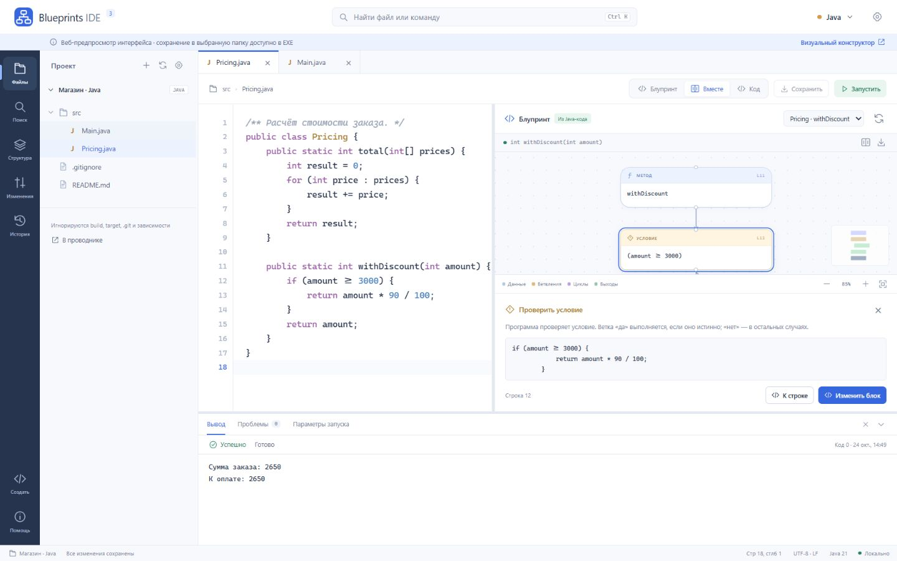

# Blueprints IDE 3

**Откройте папку с Java-проектом — и читайте его логику в блупринтах.** Меняйте блоки, переходите к исходному коду, сохраняйте файлы и запускайте настоящую Java. Всё работает локально.



## Открыть приложение

**Windows 10/11 x64:** двойной клик **[Blueprints-IDE-3.exe](output/desktop/Blueprints-IDE-3.exe)**. На первом запуске он распакует IDE и Java в пользовательскую папку. Администратор, отдельный JDK, Node и интернет для работы не нужны.

Есть **[переносимый ZIP](output/desktop/Blueprints-IDE-3-Windows-x64.zip)**: распакуйте его целиком и откройте `BlueprintsIDE.exe`. Не переносите внутренний EXE отдельно от папки. В подготовленном checkout можно открыть `start-ide.cmd`.

EXE не подписан коммерческим сертификатом; Windows может показать предупреждение о неизвестном издателе. Контрольные суммы: [SHA256SUMS.txt](output/desktop/SHA256SUMS.txt). Для macOS и Linux нужны отдельные сборки.

## За одну минуту

1. **Открыть папку** → выберите существующий Java-проект.
2. Откройте `.java` в дереве файлов и выберите метод над блупринтом.
3. Нажмите блок: IDE объяснит его назначение. **К строке** откроет Java-код.
4. **Изменить блок** → измените условие или инструкцию. Java-парсер отклонит синтаксически неверную правку.
5. **Ctrl+S** сохраняет файл обратно в вашу папку. **F5** сохраняет изменения, компилирует проект и показывает результат JVM.

Для знакомства откройте папку `examples` из переносимого комплекта или создайте **Новый проект**. Есть режимы **Блупринт**, **Вместе**, **Код**.

## Рабочее место

| Возможность | Что работает |
|---|---|
| Папки как в привычной IDE | Нативный выбор доступной папки, вложенное дерево, недавние проекты, восстановление вкладок |
| Java → блупринты | AST javac, методы, цветные блоки, связи, панорама, масштаб, миникарта, экспорт SVG |
| Правки в обе стороны | Редактор Java; блок → проверенная правка исходника → сохранение в проект |
| Редактор | Подсветка, отступы, скобки, комментарии, перенос и дублирование строк, undo/redo, поиск/замена, переход к строке, Java-шаблоны |
| Поиск проекта | Регистр, слова целиком, фильтр пути, переход к совпадению, diff перед массовой заменой |
| Защита изменений | Проверка хеша перед сохранением, сравнение с внешней версией, локальная история до 20 версий |
| Файлы | Создание из шаблонов, папки, переименование, корзина Windows, проводник |
| Запуск | Комплектная Java 21, пакеты, несколько файлов, выбор main, stdin, stdout/stderr, ошибки со строками, остановка |
| Git | Статус, ветка и diff при установленном Git; коммиты не выполняются |
| Интерфейс | Светлая/тёмная темы, настройки кода, изменяемые панели, палитра команд |
| Другие языки | Python, JavaScript, TypeScript, Kotlin, C#, C++, Go, Rust — **Coming soon** |

## Три способа работать

- **Настольная IDE:** папки, существующая Java, файлы и запуск. [Инструкция](docs/DESKTOP.md).
- **Визуальный конструктор:** новая программа полностью из блоков и форм. [Инструкция](README-BUILDER.md), раздел **Создать** в IDE.
- **Расширенная Studio:** рефакторинг, сравнительные тесты, benchmark, mutation testing, контрпримеры и evidence. [Инструкция](README-EXPERT.md), команда **Открыть лабораторию анализа Java**.

Браузерный предпросмотр: `http://localhost:8080/ide.html`. **Посмотреть на готовом примере** открывает редактируемый пример в памяти страницы. Импорт папки в браузере даёт снимок только для чтения; запись в выбранную папку выполняется EXE.

## Проверка и сборка

**272 автоматических тестов:** 201 unit, 22 базовых API/JVM, 36 Studio API/JVM, 6 Builder API/JVM, 7 проверок настольного runtime. Отдельно проверяется настоящий запуск приложения в development, переносимой и single-EXE сборках.

```powershell
python tests/verify.py
python tests/build_desktop.py
python tests/test_desktop_smoke.py portable
python tests/test_desktop_smoke.py single-exe
python tests/source_audit.py
```

Для разработки: JDK 21+, Node 22+, Python 3.11+; для сборки Windows EXE — системный .NET Framework C# compiler. Официальный Electron скачивается один раз с проверкой upstream SHA-256. Само приложение этих инструментов не требует.

[Результаты тестов](docs/verification-summary.json) · [Runtime](docs/desktop-runtime-summary.json) · [Релиз](docs/desktop-release.json) · [Аудит строк](docs/SOURCE-AUDIT.md) · [Архитектура](docs/ARCHITECTURE.md) · [API](docs/API.md) · [Защита](docs/DEMO.md)

## Честные границы

Полный отладчик JVM, language server и автоматическое разрешение зависимостей Maven/Gradle пока не реализованы. Такие проекты можно открыть и читать; встроенный запуск компилирует до 300 Java-файлов и 8 МиБ исходников стандартной Java 21, без annotation processors и build-скриптов. Текстовый файл — до 2 МиБ; граф Java-файла — до 250 000 символов.

Запуск выполняется с правами пользователя: используйте доверенные программы. Лимиты времени, памяти и вывода не являются sandbox. Символические ссылки внутри проекта не обходятся. Сложные Java-конструкции сохраняются в исходнике; граф исключений консервативен. Конечные тесты не доказывают эквивалентность на всех входах.

Исходники и PDF — `output/Java-Blueprints-complete.zip`, Windows-приложение — `output/desktop`. По выбору владельца комплект остаётся **только локальным**; публикация и загрузка файлов в облако не выполняются.
