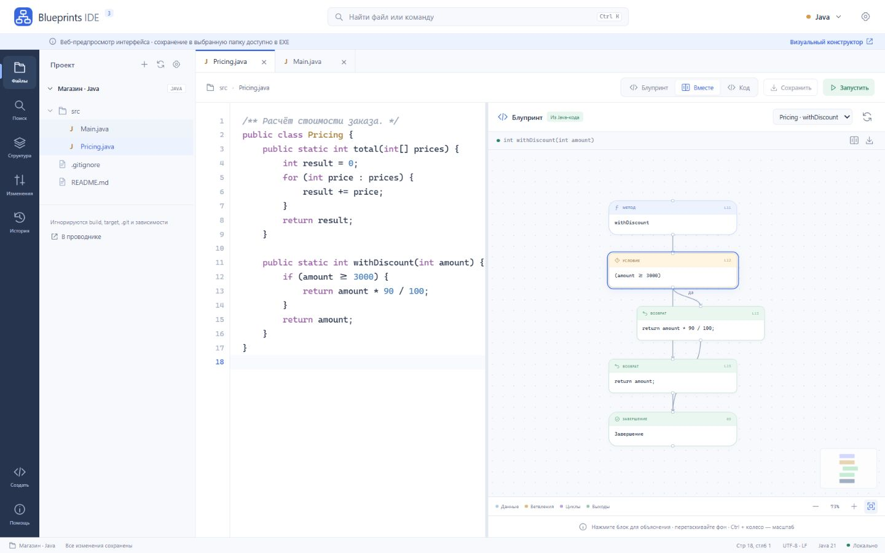

# Blueprints IDE 4 — Java ↔ блупринты, анализ и проверка поведения

**Настольная IDE для разбора Java-монолита.** Откройте проект: методы станут блок-схемами (блупринтами), IDE найдёт дефекты и сложные места, оценит Big O, предложит оптимизацию и декомпозицию. Затем она соберёт эталон и новую версию настоящим `javac`, запустит обе на тестах и докажет, что поведение не изменилось.

Решение кейса AXENIX «Визуальная среда программирования Java Blueprints». Один продукт, одно окно. Работает локально: Java 21 уже внутри, интернет и аккаунт не нужны.



## Полный путь кейса в одном окне

| Шаг кейса | Как это выглядит в IDE |
|---|---|
| 01 Загрузить `.java` | «Открыть папку» или «Открыть пример монолита». Проекты с пакетами, до 300 файлов |
| 02 Разобрать код | Стандартный AST `javac`, синтаксические ошибки со строкой в панели «Проблемы» |
| 03 Построить граф | Блупринт выбранного метода: условия, циклы, switch, try/catch, return/break/continue |
| 04 Исследовать и править | Режимы «Блупринт / Вместе / Код». Клик по блоку ведёт к строке. Блок можно изменить, добавить до или после и удалить — правка проверяется парсером и сразу появляется в Java |
| Диагностика и Big O | «Анализ»: 31 правило с объяснением и рекомендацией. Сложность каждого метода с обоснованием «почему O(n²)». Проблемные блоки помечены прямо на схеме |
| Оптимизация | «Улучшения»: 7 типов AST-преобразований (частотный индекс вместо парного обхода, HashSet вместо поиска в списке, StringBuilder и др.). Перед применением показывается diff и условия применимости |
| Декомпозиция монолита | Группы методов по ответственности (ввод, вычисления, вывод, проверки) выносятся в новые классы. В монолите остаются делегаты, обращения к оставшимся членам квалифицируются автоматически |
| 05 Собрать Java | Изменения живут в обычных `.java`. Ctrl+S сохраняет файл, локальная история хранит предыдущие версии |
| 06 Запустить и сравнить | «Проверить» (F6): эталон и текущая версия компилируются и запускаются в отдельных JVM на тестовых входах. Сравниваются stdout, stderr и код завершения |

После каждого применённого улучшения или декомпозиции IDE сама запускает проверку поведения и показывает результат: «Поведение сохранено 6/6» или построчный diff расхождения.

## Запуск

**Windows 10/11 x64:** распакуйте `Blueprints-IDE-4-Windows-x64.zip` целиком и откройте `BlueprintsIDE.exe`. Есть и один файл `Blueprints-IDE-4.exe`: при первом запуске он распакует IDE в профиль пользователя. Администратор, JDK, Node и интернет не нужны.

Сначала откройте **«Открыть пример монолита»**: это интернет-магазин примерно на 900 строк с тестами (`examples/shop-monolith`). IDE копирует примеры в `Документы\Blueprints IDE`, поэтому оригиналы не меняются.

**Веб-версия из исходников** (нужен JDK 21+):

```powershell
.\start.ps1 -TrustedLocal
```

Затем откройте `http://localhost:8080`. В браузере работают те же панели. Пример открывается в памяти страницы; запись в папку на диске доступна в EXE.

## Демо за пять минут

1. «Открыть пример монолита» → откроется `ShopMonolith.java`, блупринт метода `main`.
2. **Анализ**: 79 методов, найденные проблемы и Big O. Клик по «Вложенные циклы: O(n²)» откроет строку 712 и подсветит узел на схеме.
3. **Улучшения** → «Индекс частот вместо парного обхода» → «Посмотреть изменение» → «Применить». Проверка поведения запустится сама: 6/6 входов совпали.
4. **Анализ → Декомпозиция → Выделить** для «Вывод результата». Появится `ShopReports.java`, монолит станет короче, проверка снова 6/6.
5. Измените условие в блоке (например, порог скидки) и нажмите F6. Проверка покажет расхождение с эталоном и diff stdout.
6. Кнопка «Отчёт» сохраняет ZIP с доказательствами: эталон, новая версия, входы, результаты, патч и HTML-отчёт.

Подробный сценарий и ответы на вопросы жюри: [docs/DEMO.md](docs/DEMO.md).

## Возможности

- **Редактор:** подсветка Java, поиск и замена, переход к строке, шаблоны, undo/redo, вкладки, автосохранение сессии.
- **Проект:** дерево файлов, поиск по проекту с предпросмотром замены, локальная история версий, Git-статус и diff.
- **Запуск:** F5 сохраняет, компилирует и запускает проект с выбранным main-классом и stdin. Ошибки компиляции показываются со строками.
- **Тестовые входы:** редактируются в панели «Проверка поведения», генерируются по seed или загружаются из `blueprints-tests.json` в корне проекта. Экспортируются обратно в JSON.
- **Лаборатория тестов:** мутационное тестирование метода (насколько хороши тесты), бенчмарк до и после для `static int f(int[])`, автоматическое уменьшение контрпримера.
- **Экспорт:** блупринт в SVG, отчёт о проверке в ZIP.

## Как устроено

```text
Electron (окно, файлы, IPC)  ──  renderer: web/ide/*  (редактор, блупринт, панели анализа и проверки)
            │                                  │ HTTP 127.0.0.1
            └── встроенная Java 21  ──  src/*.java: AST javac, граф, правила, Big O, планы, декомпозиция,
                                                    компиляция и запуск в отдельных JVM, сравнение
```

Исходник Java всегда остаётся источником истины, блупринт — его проекция. Каждая правка с блупринта или из «Улучшений» — это точечная замена фрагмента исходника, проверенная парсером. Подробнее: [docs/ARCHITECTURE.md](docs/ARCHITECTURE.md), [docs/API.md](docs/API.md).

## Проверка

```powershell
python tests/verify.py
```

Скрипт собирает движок и запускает unit-тесты интерфейса, затем интеграционные тесты на настоящем `javac` и отдельных JVM (API, анализ, планы, декомпозиция, проверка поведения на всех примерах). Последний результат лежит в [docs/verification-summary.json](docs/verification-summary.json), описание наборов — в [docs/TESTING.md](docs/TESTING.md).

Сборка Windows-версии: `python tests/build_desktop.py` (официальный Electron скачивается один раз с проверкой SHA-256). Для разработки нужны JDK 21+, Node 22+, Python 3.11+.

## Соответствие кейсу и границы

Обязательный Java scope (язык и `java.lang`, консольный ввод-вывод, коллекции `java.util`, исключения) и бонусы (record, enum, дженерики, лямбды, Stream API) разобраны в [docs/SCOPE.md](docs/SCOPE.md) с указанием, где каждый пункт проверяется.

Честные ограничения:

- Big O, правила и граф вызовов — объяснимые эвристики по AST без полного вывода типов. Окончательное слово за проверкой поведения.
- Проверка поведения сравнивает программы на конечном наборе входов. Это сильное свидетельство, но не доказательство эквивалентности на всех данных. Кадры стека в stderr сравниваются без номеров строк, потому что рефакторинг законно сдвигает строки.
- Оптимизации срабатывают только там, где их корректность проверяется по структуре кода. Декомпозиция переносит static-методы. Методы экземпляра, enum и интерфейсов остаются на месте, и IDE объясняет, почему.
- Запуск программ идёт с правами пользователя: лимиты времени, памяти и вывода есть, но это не песочница. Открывайте только код, которому доверяете.
- Maven/Gradle-проекты можно читать и анализировать; зависимости автоматически не загружаются.
