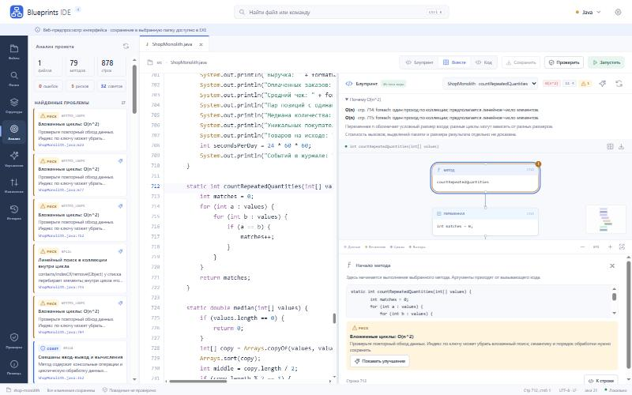
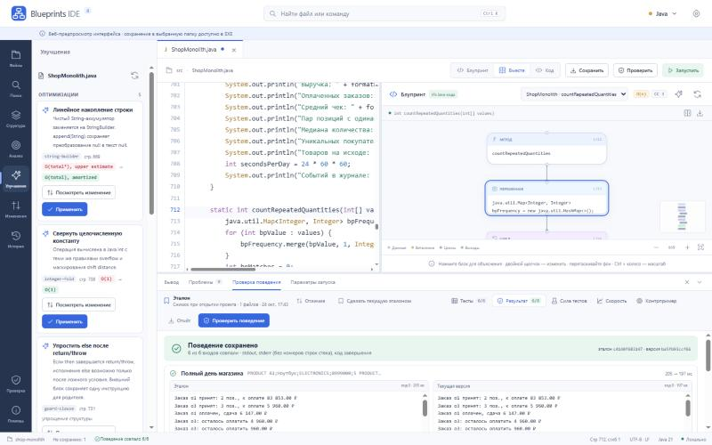
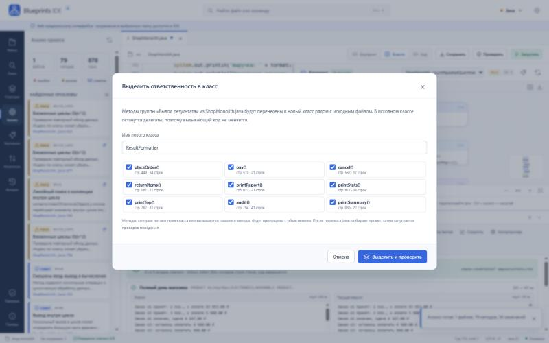

# Blueprints IDE 4.3 — разобраться в Java-монолите и менять его без страха

**Настольная IDE, где Java строится из блоков.** Идея визуального программирования та же, что у Blueprints в Unreal Engine, но визуальный язык свой: карточки с цветной полосой категории, ромбовидные порты потока, порты данных по цвету типа, ортогональные провода со стрелками направления. Провода тянутся, переподключаются и получают точки перегиба, а Java генерируется из графа. Существующий проект импортируется в такой же граф: IDE найдёт дефекты и сложные места, оценит Big O, предложит оптимизацию и декомпозицию. Затем она соберёт исходная версия и новую версию настоящим `javac`, запустит обе на тестовых входах и сравнит поведение: stdout, stderr и код завершения.

Решение кейса AXENIX «Визуальная среда программирования Java Blueprints». Один продукт, одно окно. Веб-приложение: аккаунт не нужен, исходники остаются в вашей папке.



## Четыре режима работы

| Режим | Задача пользователя | Что на экране |
|---|---|---|
| **Обзор** | Что это за программа и с чего начать | Паспорт проекта, путь данных (ввод → проверки → вычисления → вывод), дерево вызовов от `main`, пять самых рискованных методов |
| **Метод** | Как работает этот метод | Код рядом со схемой. «Схема» — схема алгоритма (циклы, условия, выходы; простые шаги свёрнуты). «Блоки» — блоки с пинами, генерирующие Java. Сверху — кто вызывает метод и что вызывает он |
| **Задачи** | Что исправить в первую очередь | Риски по приоритету с кнопкой «Исправить и проверить», ускорения, упрощения, разделение монолита. После изменения — «Принять» или «Откатить» |
| **Проверка** | Ничего не сломалось? | Исходная версия → ваши изменения → тестовые входы → результат сравнения, детали по каждому входу |

Для кого, какие сценарии и на какие продукты ориентировались: [docs/PRODUCT.md](docs/PRODUCT.md).

## Полный путь кейса в одном окне

| Шаг кейса | Как это выглядит в IDE |
|---|---|
| 01 Загрузить `.java` | «Открыть папку» или «Открыть пример монолита». Проекты с пакетами, до 300 файлов |
| 02 Разобрать код | Стандартный AST `javac`, синтаксические ошибки со строкой в панели «Проблемы» |
| 03 Построить граф | Метод превращается в граф узлов: Entry с параметрами, Branch (Да / Нет / Затем), While, For, ForEach, Set/Get переменных, операторы, вызовы, Return. Конструкции без своего узла сохраняются узлом «Java» с исходным текстом |
| 04 Строить и править блоками | ПКМ по полю — палитра узлов; провод от пина, отпущенный в пустоту, предлагает подходящий узел. Провода переподключаются перетаскиванием, Alt+клик рвёт связи, двойной клик ставит точку перегиба. Панель переменных показывает все чтения и записи. Каждая правка графа сразу генерирует Java в редакторе; «Новый метод» создаёт пустой метод для сборки с нуля |
| Диагностика и Big O | «Анализ»: 31 правило с объяснением и рекомендацией. Сложность каждого метода с обоснованием «почему O(n²)». Проблемные блоки помечены прямо на схеме |
| Оптимизация | «Улучшения»: 7 типов AST-преобразований (частотный индекс вместо парного обхода, HashSet вместо поиска в списке, StringBuilder и др.). Перед применением показывается diff и условия применимости |
| Декомпозиция монолита | Группы методов по ответственности (ввод, вычисления, вывод, проверки) выносятся в новые классы. В монолите остаются делегаты, обращения к оставшимся членам квалифицируются автоматически |
| 05 Собрать Java | Изменения живут в обычных `.java`. Ctrl+S сохраняет файл, локальная история хранит предыдущие версии |
| 06 Запустить и сравнить | «Проверить» (F6): исходная версия и текущая версия компилируются и запускаются в отдельных JVM на тестовых входах. Сравниваются stdout побайтно, stderr побайтно без строк кадров стека JVM и код завершения. Ошибка инфраструктуры даёт «не определено», а не «пройдено» |

После каждого применённого улучшения или декомпозиции IDE сама запускает проверку поведения и показывает результат: «Поведение сохранено 6/6» или построчный diff расхождения.





## Запуск

Продукт — веб-приложение: Java-движок отдаёт интерфейс и API, открыть его можно в любом современном браузере. Устанавливать приложение не нужно.

**Локально** (нужен JDK 21+):

```powershell
.\start.ps1 -TrustedLocal
```

На Linux и macOS: `./start.sh`. Затем откройте `http://localhost:8080`.

**Как сервис** (Docker, без доступа к хосту у запускаемого кода):

```bash
docker compose up --build
```

Контейнер работает с read-only файловой системой, без capabilities, с ограничением памяти, процессов и процессора. Анализ и запуск выполняются на сервере, поэтому открывайте им только код, которому доверяете: запуск чужой Java — это исполнение чужого кода.

Сначала нажмите **«Открыть пример монолита»**: интернет-магазин на 878 строк с тестами (`examples/shop-monolith`).

**Работа с вашей папкой.** «Открыть папку» в Chrome и Edge даёт браузеру доступ к выбранной папке на чтение и запись: Ctrl+S, создание, переименование и удаление файлов сразу попадают на диск. В Firefox и Safari этого API нет, папка открывается копией в памяти страницы, а сохранить результат можно кнопкой «Скачать ZIP».

## Код из блоков

1. Откройте любой Java-файл, нажмите **Новый метод** над схемой: например `int add(int a, int b)`.
2. В панели переменных нажмите **Get** у `a` и `b`, ПКМ по полю → «a + b».
3. Протяните провода: `a` → вход A, `b` → вход B, выход суммы → вход «Значение» узла Return.
4. В коде сразу появится `return a + b;`. F5 запускает программу, F6 проверяет поведение.

Импорт и генерация проверяются круговым тестом: каждый метод всех примеров импортируется в граф, Java генерируется обратно, и проверка поведения совпадает (`tests/blueprint_roundtrip.mjs`).

## Демо за пять минут

1. «Открыть пример монолита» → откроется **Обзор**: 13 классов, 79 методов, точка входа `ShopMonolith.main`, дерево вызовов показывает разбор 11 команд.
2. «Разобраться в коде» → **Метод** `main`: код рядом со схемой шагов. Клик по `execute()` над схемой — переход к разбору команд, «Назад» — возврат.
3. **Задачи** → риск «Вложенные циклы: O(n²)» в `countRepeatedQuantities` → «Исправить и проверить». IDE применит индекс частот и запустит исходная версия и новую версию: 6/6 входов совпали. «Принять и сохранить» или «Откатить».
4. **Задачи → Разделить монолит → Выделить класс** для `ResultFormatter` (вывод). Появится новый файл с методами, монолит станет короче, проверка снова 6/6.
5. **Метод → Блоки**: измените условие (например, порог скидки) и откройте **Проверку**. Она покажет расхождение с исходной версией и diff stdout; «Откатить» вернёт код.
6. Кнопка «Отчёт» сохраняет ZIP с материалами проверки: исходная версия, новая версия, входы, результаты, патч и HTML-отчёт.

Подробный сценарий и ответы на вопросы жюри: [docs/DEMO.md](docs/DEMO.md).

## Возможности

- **Редактор:** подсветка Java, поиск и замена, переход к строке, шаблоны, undo/redo, вкладки, автосохранение сессии.
- **Проект:** дерево файлов, поиск по проекту с предпросмотром замены, локальная история версий, Git-статус и diff.
- **Запуск:** F5 сохраняет, компилирует и запускает проект с выбранным main-классом и stdin. Ошибки компиляции показываются со строками.
- **Тестовые входы:** редактируются в панели «Проверка поведения», генерируются по seed или загружаются из `blueprints-tests.json` в корне проекта. Экспортируются обратно в JSON.
- **Лаборатория тестов:** мутационное тестирование метода (насколько хороши тесты), бенчмарк до и после для `static int f(int[])`, автоматическое уменьшение контрпримера.
- **Экспорт:** схему в SVG, отчёт о проверке в ZIP.

## Как устроено

```text
Браузер: web/ide/*  (режимы, редактор, схема метода, блоки, панели)   ── File System Access API ──  папка на диске
            │ HTTP JSON
            └── Java 21: src/*.java  (AST javac, граф, правила, Big O, планы, декомпозиция,
                                       компиляция и запуск в отдельных JVM, сравнение)
```

Исходник Java всегда остаётся источником истины, схему — его проекция. Каждая правка с схемы или из «Улучшений» — это точечная замена фрагмента исходника, проверенная парсером. Подробнее: [docs/ARCHITECTURE.md](docs/ARCHITECTURE.md), [docs/API.md](docs/API.md).

## Проверка

```powershell
python tests/verify.py
```

Скрипт собирает движок и запускает unit-тесты интерфейса, затем интеграционные тесты на настоящем `javac` и отдельных JVM (API, анализ, планы, декомпозиция, проверка поведения на всех примерах). Последний результат лежит в [docs/verification-summary.json](docs/verification-summary.json), описание наборов — в [docs/TESTING.md](docs/TESTING.md).

Для разработки нужны JDK 21+, Node 22+, Python 3.11+.

## Аудит

Версия 4.2.0 закрывает все P0-замечания независимого аудита версии 4.1.0. Соответствие замечаний исправлениям, регрессионные тесты и оставшиеся ограничения: [docs/AUDIT-RESPONSE.md](docs/AUDIT-RESPONSE.md).

## Соответствие кейсу и границы

Обязательный Java scope (язык и `java.lang`, консольный ввод-вывод, коллекции `java.util`, исключения) и бонусы (record, enum, дженерики, лямбды, Stream API) разобраны в [docs/SCOPE.md](docs/SCOPE.md) с указанием, где каждый пункт проверяется.

Честные ограничения:

- Big O, правила и граф вызовов — объяснимые эвристики по AST без полного вывода типов. Окончательное слово за проверкой поведения.
- Проверка поведения сравнивает программы на конечном наборе входов. Это сильное свидетельство, но не доказательство эквивалентности на всех данных. Из stderr исключаются только строки кадров стека JVM (`	at …`, `... N more`), потому что рефакторинг законно сдвигает номера строк; остальной текст stderr сравнивается побайтно.
- Оптимизации срабатывают только там, где их корректность проверяется по структуре кода. Декомпозиция переносит static-методы. Методы экземпляра, enum и интерфейсов остаются на месте, и IDE объясняет, почему.
- Запуск программ идёт с правами пользователя: лимиты времени, памяти и вывода есть, но это не песочница. Открывайте только код, которому доверяете.
- Maven/Gradle-проекты можно читать и анализировать; зависимости автоматически не загружаются.
