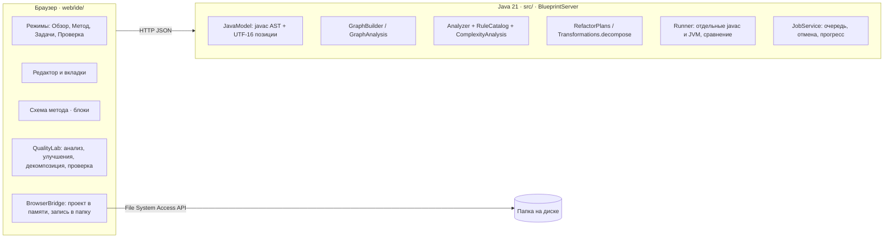

# Архитектура Blueprints IDE

Веб-приложение из двух слоёв: интерфейс в браузере и движок на Java 21, который разбирает, анализирует, преобразует, компилирует и запускает код. Файлы проекта браузер читает и пишет сам через File System Access API.

## Слои

**Файлы.** `BrowserBridge` держит проект в памяти и зеркалирует каждое изменение в выбранную папку (запись, создание, переименование, удаление). Память обновляется только после успешной записи на диск, поэтому при ошибке доступа редактор не расходится с папкой. Запись с проверкой ожидаемого хеша: если файл изменился между чтением и сохранением, правка отклоняется. В браузерах без File System Access API папка открывается копией в памяти, сохраняет её ZIP-экспорт.

**Интерфейс** (`web/ide/`) — нативные ES-модули без фреймворков и зависимостей:

| Модуль | Ответственность |
|---|---|
| `app.mjs` | Состояние IDE, вкладки, боковые панели, нижняя панель, команды и горячие клавиши |
| `documents.mjs`, `editor.mjs` | Модель документа (ревизии, undo/redo, EOL, BOM) и редактор кода |
| `../components/graph.mjs` | Схема: раскладка, маршрутизация рёбер, масштаб, миникарта, маркеры проблем |
| `quality.mjs`, `quality-views.mjs` | Анализ проекта, улучшения, декомпозиция, исходная версия, тестовые входы, проверка поведения, лаборатория, экспорт отчёта |
| `bridge.mjs` | Проект в памяти, чтение и запись папки через File System Access API, запуск через HTTP |
| `workspace.mjs`, `tools.mjs` | Режимы (карта проекта, задачи, контекст метода, схема для чтения) и меню «Инструменты» |

**Движок** (`src/`) — JDK HttpServer, раздаёт интерфейс и API, проверяет Host и Origin. Тяжёлые операции выполняются как задания `JobService` (2 worker, очередь, отмена, стадии).

## Java ↔ схему

1. Редактор отдаёт текст файла в `POST /api/analyze`. `JavaModel` строит AST через `JavacTask.parse` и сохраняет позиции в UTF-16, совпадающие с JavaScript-строками.
2. `GraphBuilder` строит для каждого метода структурный граф: вход и выход, инструкции, условия, switch, циклы, try/catch/finally, переходы. У каждого узла есть диапазон исходника и редактируемый фрагмент.
3. Правка с схемы (`POST /api/edit`: replace, before, after, delete) заменяет ровно этот диапазон. Результат заново разбирается; синтаксически неверная правка отклоняется, нетронутый текст и комментарии сохраняются.
4. Редактор получает новый исходник, документ получает новую ревизию, а устаревшие ответы с прошлых ревизий отбрасываются.

Исходник всегда остаётся источником истины. Схема — его проекция, а не отдельная модель, поэтому любой Java-код открывается без конвертации.

## Анализ

`POST /api/project` получает все Java-файлы проекта (содержимое открытых вкладок важнее диска) и возвращает:

- **Находки** — 5 правил `Analyzer` и 26 правил `RuleCatalog`. У каждой есть файл, строка, диапазон, объяснение, рекомендация и уровень доверия: syntactic или type-lexical. Типы переменных берутся из объявлений в методе и полях; полного вывода типов нет.
- **Сложность** — `ComplexityAnalysis`: последовательные участки складываются через максимум, вложенные циклы перемножаются, литеральная граница цикла считается константой, геометрический шаг даёт log. Вместе с оценкой приходят строки-источники и допущения.
- **Граф вызовов и hotspots** — разрешение по имени, арности и владельцу, SCC для циклов, ранжирование `2·CC + 1.5·cognitive + 0.15·lines`.
- **Ответственности** — группы методов (ввод, вывод, проверки, вычисления, вспомогательное) с предложенным именем класса.
- **Флаг автоулучшения** — находка помечается, если с её диапазоном пересекается план оптимизации.

IDE запускает анализ проекта в фоне при открытии. Проблемные узлы помечаются на схеме, Big O метода показывается в заголовке схемы.

## Улучшения

`RefactorPlans` пересчитывает предложения по текущему исходнику. Каждый план содержит диапазон, текст до и после, оценку сложности до и после, память, обоснование и условия применимости. Применение (`POST /api/plans/apply`) повторно вычисляет планы, сверяет SHA-256 исходника и отклоняет устаревшие или пересекающиеся планы. Подсунуть свой текст под видом плана нельзя.

| План | Шаблон | Условия корректности |
|---|---|---|
| `histogram-pairs` | Подсчёт равных пар двумя вложенными циклами по `int[]` | Чистый счётчик, сохраняется переполнение int |
| `contains-to-set` | `list.contains(x)` внутри цикла | Список локальный или параметр, не меняется и не передаётся в цикле; тип элементов согласует equals/hashCode |
| `dedupe-set` | `if (!list.contains(x)) list.add(x)` | Список локальный, создан пустым, меняется только этим шаблоном |
| `string-builder` | Накопление строки `+=` по массиву | Метод `String f(String[])` из трёх инструкций |
| `integer-fold` | Константное выражение int | Без деления на ноль, с семантикой переполнения и сдвигов |
| `constant-branch` | `if (true/false)` | Литерал без побочных эффектов |
| `guard-clause` | `else` после `return/throw` | Блоки и однократное вычисление условия сохраняются |

## Декомпозиция

`POST /api/decompose` переносит выбранные методы в новый класс рядом с исходным файлом, в том же пакете и с теми же import.

1. Отбираются static-методы обычных классов. Точка входа, методы экземпляра, enum, интерфейсов и record, synchronized/native и аннотированные методы остаются на месте с причиной.
2. Ссылки на неприватные static-поля, вложенные типы и остающиеся методы исходного класса квалифицируются его именем (`PRODUCTS` → `ShopMonolith.PRODUCTS`). Пространства имён методов и переменных учитываются раздельно. Метки `case` не трогаются.
3. Тела в исходном классе заменяются делегатами с той же сигнатурой, поэтому вызывающий код не меняется.
4. `javac` собирает весь проект. Методы, на которые указывают ошибки компиляции, исключаются, и попытка повторяется (до 4 раундов).

IDE создаёт новый файл, обновляет монолит в редакторе и сразу запускает проверку поведения.

## Проверка поведения

**Исходная версия** — снимок Java-файлов проекта с диска в момент первого открытия. Его можно заново зафиксировать кнопкой «Считать текущую исходной». Исходная версия и тестовые входы хранятся в данных IDE (`%APPDATA%`), а не в папке пользователя. Если в корне проекта есть `blueprints-tests.json`, входы и main-класс загружаются из него.

**Прогон** (`kind: compare`): исходная версия и текущая версия компилируются в отдельных временных каталогах (`javac --release 21 -encoding UTF-8 -proc:none`, список файлов через argfile). Затем на каждом входе каждая версия запускается в отдельной JVM: heap 96 МиБ, 5 с на запуск, 64 КиБ вывода на поток. Вход совпал, если совпали:

- байты stdout (SHA-256);
- stderr без строк стека `at …` и `... N more` — рефакторинг законно сдвигает номера строк, а тип и текст исключения сравниваются;
- код завершения;
- ни одна версия не упёрлась в таймаут или лимит вывода.

Результат привязан к хешам версий. Любая правка помечает его устаревшим. Отчёт ZIP содержит обе версии, входы, результаты, patch, анализ и автономный HTML.

**Лаборатория** использует тот же механизм: мутационное тестирование (сила набора входов), бенчмарк `static int f(int[])` внутри JVM (прогрев, медиана, клон входа вне таймера) и delta debugging для уменьшения контрпримера.

## Безопасность и ограничения

- Сервер слушает 127.0.0.1, проверяет Host/Origin, ограничивает тело запроса 16 МБ. Пути файлов валидируются: никаких `..`, дисков и пустых сегментов.
- Пользовательская программа выполняется с правами пользователя. Таймауты, лимиты памяти и вывода защищают IDE, но это не песочница.
- Анализ лексико-синтаксический: перегрузки и динамическая диспетчеризация разрешаются приблизительно, поэтому правила формулируются как рекомендации.
- Задания живут в памяти движка и после перезапуска не сохраняются. Исходная версия и входы сохраняются.

## Решения и цена

| Решение | Почему | Цена |
|---|---|---|
| Стандартный `javac` и JVM вместо своего интерпретатора | Настоящая семантика Java и стандартной библиотеки | В комплекте полный JDK runtime (~100 МБ) |
| Правки диапазонами исходника | Комментарии и форматирование не теряются | Структурные правки ограничены операциями над узлами |
| Ноль runtime-зависимостей в интерфейсе | Запуск без сети и сборщиков | Собственные diff, раскладка графа и ZIP покрыты тестами |
| Дифференциальная проверка поведения | Проверяемый результат, понятный пользователю | Свидетельство на конечных входах, а не формальное доказательство |
